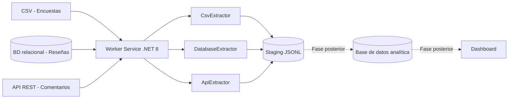
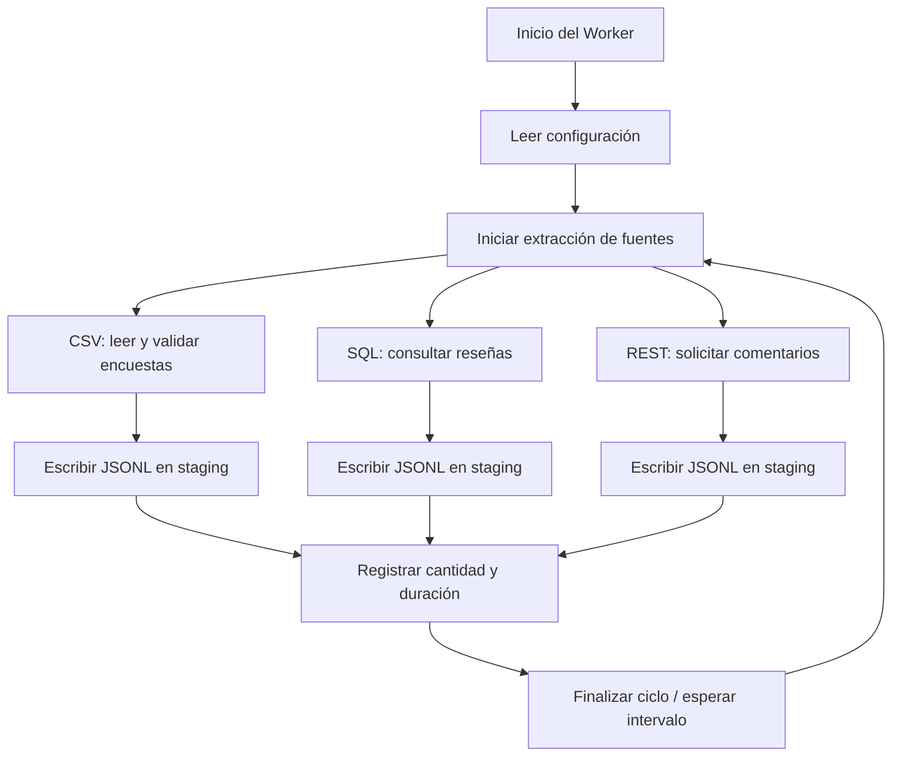

# FeedbackETL - Actividad 1

Implementación inicial de la fase **Extracción (E)** de un proceso ETL con .NET 8 Worker Service.

## Alcance y supuesto de trabajo

Como el mandato no especifica el dominio concreto del proyecto, esta primera versión utiliza un caso demostrativo de análisis de opiniones y satisfacción:
- CSV: encuestas internas.
- Base de datos relacional: reseñas de clientes.
- API REST: comentarios externos (el endpoint de demostración es JSONPlaceholder).

Este dominio es una decisión provisional para poder construir una base ejecutable. Se puede adaptar al proyecto definitivo sin cambiar la arquitectura general.

## Arquitectura

- `FeedbackETL.Domain`: entidades del dominio.
- `FeedbackETL.Application`: contratos `IExtractor<T>` e `IStagingWriter<T>`.
- `FeedbackETL.Infrastructure`: extractores CSV, SQL Server y REST; escritura de staging.
- `FeedbackETL.Worker`: composición de dependencias y ejecución en segundo plano.

## Requisitos

- SDK de .NET 8.
- SQL Server accesible.
- Una tabla `dbo.Reviews` con columnas `Id`, `CustomerName`, `Rating`, `Comment`, `CreatedAt`.
- Conexión a Internet para consumir el endpoint REST de demostración.

## Preparación de la base de datos de ejemplo

```sql
CREATE TABLE dbo.Reviews
(
    Id INT NOT NULL PRIMARY KEY,
    CustomerName NVARCHAR(150) NOT NULL,
    Rating INT NOT NULL,
    Comment NVARCHAR(2000) NULL,
    CreatedAt DATETIME2 NOT NULL
);

INSERT INTO dbo.Reviews (Id, CustomerName, Rating, Comment, CreatedAt)
VALUES
(1, 'Cliente de prueba', 5, 'Servicio satisfactorio', SYSUTCDATETIME()),
(2, 'Cliente de prueba 2', 3, 'Experiencia regular', SYSUTCDATETIME());
```

## Configurar credenciales sin publicarlas

No escribas contraseñas en `appsettings.json` ni las subas a GitHub. Desde la carpeta del proyecto Worker:

```bash
dotnet user-secrets init
dotnet user-secrets set "ConnectionStrings:ReviewsDb" "Server=SERVIDOR;Database=FeedbackDB;User Id=USUARIO;Password=CLAVE;Encrypt=True;TrustServerCertificate=False;"
```

En producción, utiliza variables de entorno o un gestor de secretos. Para variable de entorno, el nombre es `ConnectionStrings__ReviewsDb`.

## Ejecutar

Desde la raíz:

```bash
dotnet restore
dotnet build
dotnet run --project FeedbackETL.Worker
```

El Worker ejecuta una extracción al iniciar y repite el ciclo según `Worker:RunIntervalMinutes`. Los archivos JSON Lines se guardan en `staging/` separados por fuente y ejecución.

## Formato CSV esperado

`Data/encuestas.csv` debe tener las columnas:

```csv
Id,SurveyDate,Department,Rating,Comment
```

## Formato de la tabla SQL esperada

La consulta configurada debe devolver exactamente los alias/columnas `Id`, `CustomerName`, `Rating`, `Comment`, `CreatedAt`.

## Evidencia de extracción

- `CsvExtractor.cs`: lectura asíncrona con CsvHelper y validación del rating.
- `DatabaseExtractor.cs`: consulta asíncrona mediante Microsoft.Data.SqlClient.
- `ApiExtractor.cs`: consumo HTTP asíncrono y deserialización incremental del arreglo JSON.
- `JsonLinesStagingWriter.cs`: escritura por registro en JSONL, sin acumular todos los registros en memoria.
- `Worker.cs`: ejecución concurrente de las tres fuentes, medición con Stopwatch y logs con ILogger.

## Limitaciones conocidas de esta primera versión

1. La consulta SQL y el mapeo de columnas están configurados para SQL Server; deben ajustarse si el proyecto usa otro motor.
2. El endpoint de demostración no requiere token. Si la API definitiva requiere autenticación, se debe agregar el mecanismo correspondiente sin guardar secretos en el repositorio.
3. El staging se escribe en archivos JSONL. El mandato permite archivos temporales o tablas staging.
4. No se implementan transformación ni carga a la base analítica porque esta actividad se concentra en la extracción.
5. Antes de una entrega productiva conviene agregar pruebas automatizadas, política de reintentos HTTP, paginación cuando la API lo requiera y manejo de ejecuciones idempotentes.

## Diagrama de arquitectura



## Diagrama de flujo de extracción


